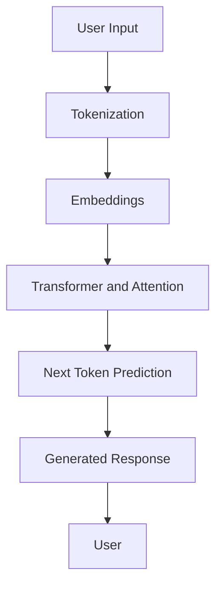

# How Large Language Models (LLMs) Work

## 1. What is an LLM?

A Large Language Model (LLM) is an artificial intelligence model trained on a large amount of text. It learns patterns in language and uses those patterns to understand prompts and generate responses.

Examples include GPT, Gemini and Llama.

## 2. How does an LLM work?

An LLM works through several important steps:

1. **Input:** The user enters a question or instruction.
2. **Tokenization:** The text is divided into smaller units called tokens.
3. **Embeddings:** Tokens are converted into numerical representations that the model can process.
4. **Transformer:** The model uses attention mechanisms to understand relationships between words and their context.
5. **Prediction:** It predicts the next token based on the previous context.
6. **Output:** Predicted tokens are combined to generate a response.

## 3. LLM Workflow Diagram

## 4. Important Concepts

### Tokens
Tokens are small pieces of text processed by an LLM. A token can represent a word, part of a word or punctuation.

### Embeddings
Embeddings represent text as numerical vectors so that a model can process its meaning and relationships.

### Transformer
A transformer is a neural network architecture used by modern LLMs to process sequences of text.

### Attention Mechanism
Attention helps the model focus on relevant parts of the input while generating a response.

### Next Token Prediction
An LLM generates text by repeatedly predicting the next likely token until the response is complete.

## 5. How LLMs Relate to MatdarMitra

MatdarMitra is designed to help users understand voter registration procedures using official Election Commission of India information.

An LLM could help MatdarMitra understand natural-language questions and explain relevant information in simple language.

For example:

**User question:** "I am applying for voter registration for the first time. Which form should I use?"

An LLM-based MatdarMitra could interpret the question and retrieve relevant information about Form 6.

However, answers about voter registration should be grounded in verified ECI documents. The system should not invent eligibility rules, official contacts or local BLO information.

## 6. Limitations of LLMs

- They can generate incorrect or misleading information.
- They may not know the latest rules.
- They can misunderstand ambiguous questions.
- They may generate information that is not supported by the available documents.

## 7. Conclusion

LLMs make it possible for computers to understand and generate human-like text. By combining language models with reliable official information, projects like MatdarMitra can make voter registration guidance easier to understand and access.